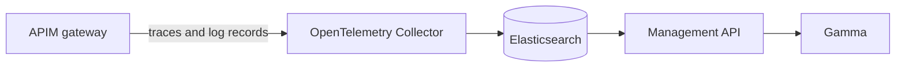

# Gamma Tracing

Gamma's Tracing pages (Agent Management > Observability > Tracing) show each call through the gateway as a timeline of spans: the flows and policies that ran, how long each took and how it ended, with the payloads that went in and came out. A call shows up a few seconds after the gateway answered.



A standard OpenTelemetry Collector (`gio-otel-collector`) takes what the gateway exports, its traces and the log records of its OpenTelemetry reporter, and writes them to the lab's Elasticsearch, where the Management API reads them. [ACME Bank](../../playgrounds/acme-bank/README.md) includes this add-on.

## Needs

Nothing more than the platform. Starting the add-on recreates the gateway and the Management API, which get the exporter and the Elasticsearch repositories.

## Ports

None published. The collector listens on the Docker network only, on 4317 (gRPC) and 4318 (HTTP). Gamma shows the traces at `http://localhost:8086/environments/default/aim/observe/tracing/<API id>/<trace id>`.

## Logins and secrets

None.

## Settings

| Setting | Default | Meaning |
|---|---|---|
| `OTEL_COLLECTOR_VERSION` | `0.163.2` | OpenTelemetry Collector version (image tag), chosen on the Images page |

The collector reads [`otel-collector.yml`](otel-collector.yml) when it starts. After you edit that file, restart it:

```bash
docker restart gio-otel-collector
```

## Trace an API

A v4 API is traced only when tracing is enabled on it, and that includes LLM, MCP and agent proxies.

- In the APIM Console, open the API, then **Deployment** > **Reporter Settings**. Under **OpenTelemetry**, switch on **Enabled**, and **Verbose** to trace the policies. **OTel Logs** keeps the request and response payloads.
- In an API definition, it is the `analytics` block: `tracing` with `enabled` and `verbose`, `otelLogs` with `enabled`, and `logging` for the payloads. [ACME Bank's LLM proxy](../../playgrounds/acme-bank/seed/apim/apis/acme-bank-llm.json) is an example.

The page of an API lists the last 5 minutes at first: pick a longer range to see older calls. A caller that sends a W3C `traceparent` header chooses the id of its trace.

It does not run together with the [AI Agent Inspector](../ai-agent-inspector/README.md), or with any add-on of yours that sets the gateway's OpenTelemetry exporter, such as a Jaeger: they all take it. Starting one stops or turns off the others, after saying so.

## What it keeps

The collector writes the data streams `traces-apim.otel-default` and `logs-apim.otel-default`, where `default` is the id of the organization in lower case. Nothing deletes what they hold: their Elasticsearch lifecycle policies roll an index over at 30 days or 50 GB and have no delete phase. The data stays until the lab is reset (`make reset`), and grows by about 90 MB a day at the rate of ACME Bank's traffic generator.

To clear it without a reset, delete the two data streams (Elasticsearch listens on port 9200 of this machine). The collector creates them again at its next write:

```
curl -X DELETE 'http://localhost:9200/_data_stream/traces-apim.otel-default,logs-apim.otel-default'
```

## What it hides

Spans carry the credentials of the calls, so the gateway masks, with `***`, every attribute whose name says api key, authorization, cookie, secret, password, credential or token before it exports it. It spares the attributes whose name says `usage` or `rate limit` (what a call used, and the limits it was given), which the Tracing pages show. A count of tokens under another name is masked with the rest.

The rule is a pattern on attribute names, set on the gateway in [`compose.yml`](compose.yml), so it covers every API that turns tracing on. A credential under another name, and a request or response body, are recorded as they are.
