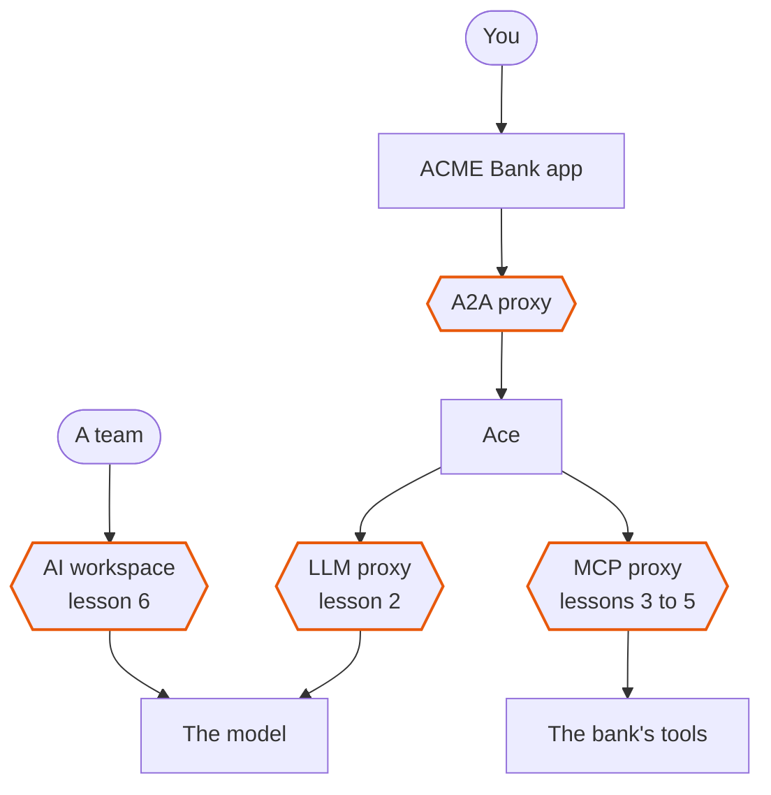
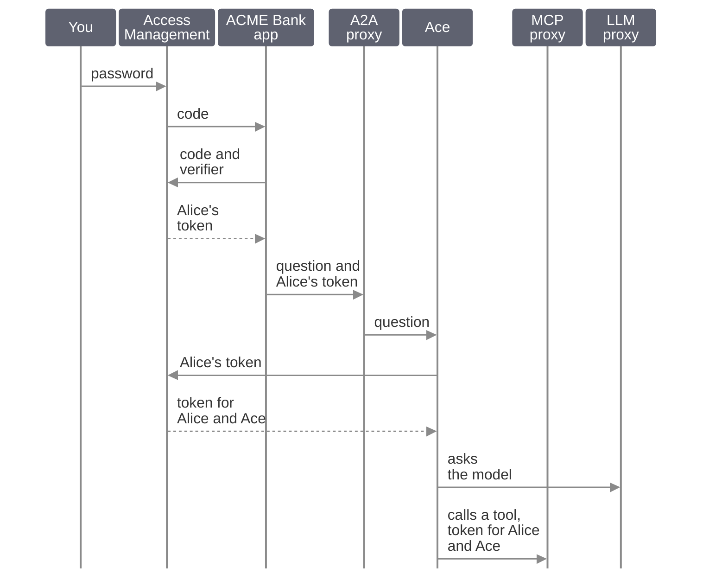

# ACME Bank: put an AI agent in production

**Would you hire someone with no badge, no manager and nobody checking their work?** That is how many AI agents go to production.

ACME Bank built **Ace**, an assistant for its customers and its tellers. Ace is an *agent*: an AI that asks a model what to do, then calls the bank's tools for the person it serves.

Dana, the platform lead, answers for Ace. When Ace does what it should not, she must explain it and put it right. You are on her team.

The hexagons are the Gravitee *gateway*. It has a *proxy* for each kind of traffic:

- the *A2A* (agent to agent) proxy carries the questions to Ace
- the *LLM* (large language model) proxy carries Ace's calls to the model
- the *MCP* (model context protocol) proxy carries Ace's calls to the bank's tools
- an *AI workspace* gives a team its own entry to the models, with a budget

### Three questions

An agent in production answers three questions. Each lesson belongs to one:

- **What may it do?** Lessons 2 to 5
- **What does it cost?** Lesson 6
- **What did it do?** Lessons 1 and 7

### The app and Gamma

- The app and *Gamma*, Gravitee's console for all of it, are tabs of this page: **ACME Bank** and **Gamma Console**.
- The buttons of this guide do what the app's **Commands** do: one click shows the app and sends the question or runs the action for you.
- A link or a button that opens Gamma shows its tab by itself. To come back, click the **ACME Bank** tab.
- **Behind the answer** lists the *hops* of an answer, the calls it was made of: a column beside the conversation in a wide window, and a button under the answer in a narrow one.
- **Presenter**, a view of the app, checks that the bank is ready and starts it over; **Re-seed**, a button of the Lab UI, sets the protections and the budgets back to how the lessons begin.

### How the lessons work

Lessons 2 to 6 have the same four beats:

- **Try**: click a button of the guide. The problem happens.
- **Look**: in Gamma, find the *protection* that would stop it. It is there, switched off.
- **Switch on**: enable it and deploy it.
- **Try again**: click the same button. The result changes.

Do the lessons in order.

### Who is Alice?

Alice and Bob are customers. Tina is a teller. All three are real users of *Access Management*, Gravitee's identity service.

- Her password goes to Access Management's login page only.
- She signs in with the *authorization code* flow: the app gets a code, and its server swaps it for her token.
- *PKCE* proves that the app asking for the token is the one that asked for the code.
- The A2A proxy checks that token before the question reaches Ace.
- Ace swaps it at Access Management for a *delegated* token, which names Alice and Ace as the *acting agent*.
- The MCP proxy decides on that token. The LLM proxy never sees it: Ace calls the model with its own key.

## 1. See everything

You cannot govern what you cannot see. Ask Ace one question twice: first with nobody signed in, then as Alice.

### Try

- Click the **Gamma Console** tab and sign in: `admin` / `admin`.

#### Without a token

- Click [Ask Ace about my accounts](action:ask-ace-accounts), with nobody signed in.
- The answer reads **The gateway refused the question**: it asks for a token, and none was sent.
- In **Behind the answer**, the hop **Someone not signed in asked Ace** reads `401` and **Unauthorized: no token was sent**.
- Click **Logs** in that hop. Within ten seconds Gamma opens the log entry of that call: `401` on `/acme-bank/ace/`.

#### As Alice

- In the **ACME Bank** tab, click **Choose who is asking**, in the refused answer. The menu of who is asking opens.
- In that menu, click the copy button beside Alice's password.
- Click **Alice Martin**: Access Management's own login page opens in a window, with her username filled in.
- Paste the password and click **Sign in**: the window closes by itself.
- The app now asks as Alice. Her round badge, with her initials, opens that menu again.
- Click [Ask Ace about my accounts](action:ask-ace-accounts) again.
- Ace answers with Alice's accounts.

### Look

#### The hops

**Behind the answer** now lists six hops, in order:

- **Alice asked Ace** (A2A proxy): Ace answered after the 5 calls below
- **Ace got a token for Alice** (Access Management): `sub Alice, acting agent ace-agent`
- **Ace asked which tools it may use** (MCP proxy): Ace may use 8 of 8 tools
- **Ace asked the model what to do** (LLM proxy): the model chose `list_accounts`
- **Ace called list_accounts** (MCP proxy): the bank's tool answered
- **Ace asked the model for the answer** (LLM proxy): the model wrote the answer

Each hop that went through the gateway reads `200`: nothing was refused.

- Each of them has its own **Trace** and **Logs**, which open that call in Gamma.
- The token hop has none: that call goes to Access Management, not through the gateway.
- When Ace kept the token from an earlier question, the token hop reads **Reused** in place of a status.

#### The call in Gamma

- Click **Trace** in the hop **Alice asked Ace**. Gamma shows the call as a *trace*, made of *spans*, one for each thing the gateway did.
- The trace starts with `POST /acme-bank/ace`.
- The 8 tools of the hop **Ace asked which tools it may use** are the ones Gamma lists in [MCP Servers](http://localhost:8086/environments/default/aim/catalog/mcp-servers) > **ACME Bank MCP**.

### Try again

The same question, with no gateway in front of Ace.

- Click [Ask Ace without the gateway](action:ask-ace-direct).
- Ace answers the same, and the answer is marked **Direct**.
- **Behind the answer** says **No gateway** where each system was, and has no **Trace** or **Logs**.
- It has no token hop: no identity went with the question.

### What you learned

- Every call through the gateway leaves a record of its own, a refused one too: a trace and a log.
- Without a token the gateway refuses the question.
- Ace acts with a token that names Alice and Ace.
- Without the gateway Ace still works, and nobody can see what it does.

## 2. Protect the model

Whatever people type reaches the model, which in production belongs to someone else.

An IBAN can leave the bank, and a *prompt injection* (a message telling the model to ignore its instructions) can steer the model.

### Try

#### The injection

- Click [Inject a prompt](action:inject-a-prompt).
- Ace answers it.
- The hop **Ace asked the model what to do** reads `200`: nothing stopped it.

#### The IBAN

- Click [Leak an IBAN](action:leak-an-iban).
- Ace answers. What it says does not matter: the proof is in the log.
- In the hop **Ace asked the model what to do**, click **Logs**.
- In Gamma, click **Request**. It shows the call to the model in two blocks.
- **CONSUMER (ENTRYPOINT)** is what Ace sent. **GATEWAY (ENDPOINT)** is what the model received.
- In each block, scroll to the message `"role": "user"`: it holds the IBAN in clear.
- Do not click **Show more**: it opens the whole prompt, with Ace's tools.

### Look

- In Gamma, open [ACME Bank LLM](http://localhost:8086/environments/default/aim/llm-proxy/00000000-0000-4000-8000-acb100000001/policy-studio), its **Policy Studio**.
- Click the sidebar icon: it hides the menu of the API and gives the studio more room.
- Under **COMMON FLOWS**, click the flow **Prompt**.
- Its **Request Phase** is a row of steps. Scroll it back to its start: hold **Shift** and turn the mouse wheel, or swipe.
- The first two steps are faded.
- Click the first, **AI - Prompt Guard Rails**. Its **Description** reads `Blocks jailbreaks and prompt injection in what the user asks`.
- Click the second, **PII Filtering**. *PII* is personal data, such as an IBAN.
- Its **Description** reads `Masks account numbers such as an IBAN before the model sees them and in what it answers`.

### Switch on

- In the panel of **PII Filtering**, click the eye icon with a slash (tooltip **Enable**).
- Click the first step, **AI - Prompt Guard Rails**, and enable it the same way.
- Click **Save**.
- Click **Deploy** in the banner **This API is out of sync**.
- Click **Deploy** in the dialog.
- Wait 30 seconds: the gateway takes the change up.

### Try again

#### The injection

- Click [Inject a prompt](action:inject-a-prompt) again.
- Ace refuses.
- The hop **Ace asked the model what to do** now reads `400` and **Blocked: AI prompt validation detected**.
- It is the last hop: the model never saw the prompt.

#### The IBAN

- Click [Leak an IBAN](action:leak-an-iban) again.
- In the hop **Ace asked the model what to do**, click **Logs**.
- In Gamma, click **Request**.
- **CONSUMER (ENTRYPOINT)** still holds the IBAN: that is what Ace sent.
- **GATEWAY (ENDPOINT)** now holds `[REDACTED]` where the IBAN was.

### What you learned

- A policy changes a call without changing the agent.
- *Guard rails* are a detector, and a detector misses some prompts: what the agent may do must hold when it fails.

## 3. Protect the tools

ACME Bank's card policy says only bank staff freeze a card.

The safest way to keep Ace from doing it for a customer is not to offer it the tool.

### Try

- Click [Freeze a card as a customer](action:freeze-card-customer).
- Ace freezes Alice's card.
- In **Behind the answer**, the hop **Ace asked which tools it may use** says **Ace may use 8 of 8 tools**.
- The hop **Ace called freeze_card** reads `200`.

### Look

- In Gamma, open [ACME Bank MCP](http://localhost:8086/environments/default/aim/mcp-proxy/44ab2daf-d0e3-362c-8d88-2d741faf7eab/policy-studio), its **Policy Studio**.
- Click the sidebar icon: it hides the menu of the API and gives the studio more room.
- Under **MCP METHOD FLOWS**, click the flow **Visible tools**.
- Its only step, **MCP ACL**, is faded. Click it.
- An *ACL*, access control list, says which role is offered which tool.
- Its **Description** reads `Offers a teller every tool and a customer all but freeze_card`: that is the rule.

### Switch on

- In the panel of the step, click the eye icon with a slash (tooltip **Enable**).
- Click **Save**.
- Click **Deploy** in the banner **This API is out of sync**.
- Click **Deploy** in the dialog.
- Wait 30 seconds: the gateway takes the change up.

### Try again

The card is still frozen from your first try.

- In the **ACME Bank** tab, open **Presenter** and click **Start the bank over**.

#### As a customer

- Click [Freeze a card as a customer](action:freeze-card-customer) again.
- Ace cannot do it: it says a teller in a branch can.
- The hop **Ace asked which tools it may use** now says **Ace may use 7 of 8 tools, not freeze_card**.
- There is no **Ace called freeze_card** hop any more.

#### As a teller

- Choose **Tina Torres** in the menu of who is asking and sign in, as you did for Alice.
- Click [Freeze a card as a teller](action:freeze-card-teller).
- For Tina, the hop **Ace asked which tools it may use** says **Ace may use 8 of 8 tools**.
- The card is frozen.

### What you learned

- The model can only choose among the tools it is offered, so the best way to keep a tool from an agent is not to offer it.
- Hiding a tool is advice, not a rule: a rule judges every call.

## 4. Decide who may do what

ACME Bank's rules already exist as authorization policies: a customer sees only their own accounts.

The gateway does not ask them yet.

### Try

- Choose **Bob Chen** in the menu of who is asking and sign in, as you did for Alice.
- Click [Read another customer's accounts](action:read-other-accounts).
- Bob reads Alice's accounts: Ace lists them.
- In **Behind the answer**, the hop **Ace called list_accounts** reads `200`.
- Click **Decisions** in that hop: it opens the policy engine's decision about that call.
- After up to 15 seconds Gamma lists none: **No logs found**. Nothing asked who may see what.

### Look

- In Gamma, open [ACME Bank MCP](http://localhost:8086/environments/default/aim/mcp-proxy/44ab2daf-d0e3-362c-8d88-2d741faf7eab/policy-studio), its **Policy Studio**.
- Click the sidebar icon: it hides the menu of the API and gives the studio more room.
- Under **MCP METHOD FLOWS**, click the flow **Authorization**.
- The last step of its **Request Phase**, **Gravitee Authorization PEP (GAPL)**, is faded. Click it.
- The *PEP*, policy enforcement point, is the step that asks. The *PDP*, policy decision point, is the engine that answers.
- Its **Description** reads `Asks the policy engine whether this person, or the agent acting for them, may call this tool on this data`.

### Switch on

- In the panel of the step, click the eye icon with a slash (tooltip **Enable**).
- Click **Save**.
- Click **Deploy** in the banner **This API is out of sync**.
- Click **Deploy** in the dialog.
- Wait 30 seconds: the gateway takes the change up.

### Try again

- Click [Read another customer's accounts](action:read-other-accounts) again.
- Ace says it is not allowed.
- The hop **Ace called list_accounts** now reads `403` and **Denied by policy: Not allowed by ACME authorization policy**.
- Click **Decisions** in that hop. Gamma opens that decision within 15 seconds.
- It reads **Outcome** `Deny` and **Verdict** `Forbid`.
- Open its **Reasons**. They name the rule: `Forbidden by policy 'Customers see only their own accounts'`.

### What you learned

- A signed-in person is not an allowed one: each call is judged by who asks, which agent acts for them and what they ask.
- An *authorization policy* is a permit or forbid statement. A forbid wins, and what no policy permits is refused.

## 5. Cap what an agent may do

The fee schedule says an assistant acting for a customer sends at most EUR 500 per transfer.

Above that, the customer uses the app or a branch. This needs lesson 4: its step is what asks the policy engine.

### Try

- Click [Move EUR 600 through Ace](action:move-600-through-ace).
- Ace moves the money.
- In **Behind the answer**, the hop **Ace called transfer_funds** reads `200`.

### Look

- In Gamma, open [MCPs](http://localhost:8086/environments/default/authz/mcps), in **Authorization Management**.
- Find the policy **Agents move at most EUR 500** and click it.
- Its status is not **Deployed**: it does not apply yet.
- Its panel shows a **forbid** on `transfer_funds` with the condition `context has agent && context has amount && context.amount > 500`.
- The condition `context has agent` makes it apply when an agent acts.

### Switch on

- Click **Deploy to PDP Runtime**.
- Wait 30 seconds: the gateway takes the change up.

### Try again

#### Through Ace

- Click [Move EUR 600 through Ace](action:move-600-through-ace) again.
- Ace says it is not allowed.
- The hop **Ace called transfer_funds** now reads `403` and **Denied by policy**.
- Click **Decisions** in that hop.
- Open its **Reasons**: `Forbidden by policy 'Agents move at most EUR 500'`.

#### Yourself

- Click [Move EUR 600 yourself](action:move-600-yourself).
- Alice pays with her own token, with no agent: the receipt says **Moved**.
- **Behind the answer** shows one hop, **Alice called transfer_funds**: `200`.

### What you learned

- Ace's token names two parties: Alice, and Ace as the *acting agent*.
- A policy can tell them apart: Alice may move 600, her agent may not.

## 6. Cap what teams spend

A model costs money on every call: each person of a team has a budget in dollars, and the gateway refuses at the limit.

The Hackathon sandbox team has $0.12 an hour: a few long answers use it all.

### Try

- Click [Spend the Hackathon budget](action:spend-hackathon-budget).
- The app opens **Teams**. The **Hackathon sandbox** team asks four long answers, one after the other: it takes under a minute.
- Each answer shows its model and the share of the budget spent: the last one reads `smart` and about **72% spent**.
- All four come from `smart`, even past the mark at 50% of the meter.
- Behind the last answer is one hop, **Hackathon sandbox asked the AI workspace**. Click **Spend** in it.
- Gamma opens the AI workspace's dashboard for this run.
- In **Models**, all four requests went to `qwen3:1.7b`: the model behind `smart`.

### Look

- In Gamma, open [AI Workspaces](http://localhost:8086/environments/default/aim/ai-workspaces) and click **ACME Bank Teams**.
- In the menu, under **ACCESS**, click **Router**.
- Close the **Policies** palette with its arrow, then click **Fit View**.
- The step **Spend-aware routing** is grayed out: switched off. Click it.
- Its two bands send a person to `smart` while **Plenty left** (under half the budget), and to `lite` once **Running low**.

### Switch on

- In the panel of the step, switch **Enabled** on.
- Click **Save**.
- Click **Deploy** in the banner **This API is out of sync**.
- Click **Deploy** in the dialog.
- Wait 30 seconds: the gateway takes the change up.

### Try again

- Click [Spend the Hackathon budget](action:spend-hackathon-budget) again. The team is past half its budget.
- The first answer reads **smart → lite**: the router moved it. The next ones read `lite`.
- The last answer is a refusal: it says **Cost budget exceeded!** and its hop reads `429`. That is the cap doing its job.
- In **Behind the answer** of a `lite` answer, click **Spend**.
- In **Models**, the requests went to `qwen3:0.6b`: the model behind `lite`.

### What you learned

- The *budget* is the cap: at the limit, the gateway refuses.
- The *router* makes the budget last: past half of it, a person moves to the cheaper model.

## 7. Prove it

Everything Ace did is on record, kept by the platform and not by Ace's own code.

### Look

#### The dashboard

- Open the dashboard [ACME Bank - AI spend and safety](http://localhost:8086/environments/default/aim/observe/dashboards/acme-bank-ai-spend-and-safety): it shows the **Last 1 hour**.
- **Prompts blocked** (HTTP 400), **Tool calls denied** (403) and **Calls limited** (429) count what the gateway refused.
- They count your clicks and the lab's background traffic, which keeps the dashboards alive.
- **No valid token** counts the calls that carried none: the first click of lesson 1 made one.
- **Consumers** names each application.
- The counts are read when the page opens: click the link again to update them.

#### The six words

The Agent Accountability Framework asks six questions of every agent. You have the answers:

- **Identity**: who are you? Ace has its own, in [Agent Identity](http://localhost:8086/environments/default/aim/agents) > **Ace**. Its token names the user and the **Acting agent**: the hop **Ace got a token for Alice** shows it.
- **Sponsor**: who answers for you? Dana, the platform lead.
- **Role**: what are you here to do? Ace helps customers and tellers with their accounts, within a token budget: the plan **Ace agent**.
- **Authority**: what can you see, and what can you do? The tools offered to a role, the policies **Decisions** names, EUR 500.
- **Oversight**: are you doing what we expect? Dashboards, Logs, Tracing and Decisions.
- **Recourse**: what happens if you don't? Dana puts it right in Gamma: she switches a protection on and deploys it, as in lessons 2 to 6.

### What you learned

- The platform records every call, whatever Ace's code does.
- That record, and the protections you can read in Gamma, are the proof: it is what lets Dana explain Ace.
- The protections of lessons 3 to 6 are *deterministic policies*: rules that run on every call, whatever the agent does.

## Start again

To do the lessons again:

- Click **Re-seed**: every protection is back in the state `ACME_BANK_PROTECTIONS` names (off by default) and the Hackathon budget is full. It takes about a minute.
- In the **ACME Bank** tab, open **Presenter** and click **Start the bank over**: the money and the cards are back.
- Click the home icon (**Back to start**): the conversation starts again.
- In the menu of who is asking, click **Sign out**: lesson 1 starts again with nobody signed in.

## Go further

Each is optional and changes nothing.

### The delegated token

- Click [Ask Ace about my accounts](action:ask-ace-accounts), then open **Tokens**.
- **User token** has **Subject**, **Role**, **Customer** and **Accounts**.
- **Delegated token** adds **Acting agent** `ace-agent`: it is the token of the hop **Ace got a token for Alice**.

### The Policy Simulator

- Open [Policy Simulator](http://localhost:8086/environments/default/authz/simulator).
- Pick **ACME Bank MCP**, a principal, an **Acting agent** and a request context value such as `amount` = `600`.
- Click **Run simulation**.

### More to look at

- [Ace, the A2A proxy](http://localhost:8086/environments/default/aim/agent-runtime): the entry in front of Ace
- [ACME Bank LLM](http://localhost:8086/environments/default/aim/llm-proxy/00000000-0000-4000-8000-acb100000001/overview): its **Plans**, **AI Semantic Caching** and **Token Rate Limit**
- In the app's **Developers** view, **Ask the cached FAQ twice** shows the cache and **Send x10** the rate limit
- [ACME Bank MCP](http://localhost:8086/environments/default/aim/mcp-proxy/44ab2daf-d0e3-362c-8d88-2d741faf7eab/overview): its OAuth2 plan and the flow **Rate limit**
- [Access Management console](http://localhost:8081): the domain `acme-bank`, with Alice, Bob and Tina, and the applications that sign them in

## If something does not work

- **Gamma shows its sign-in page, or a blank page after it.**
  Sign in (`admin` / `admin`), go back to the app and press the button again.
- **The result is still the unprotected one after you deployed.**
  The gateway takes about 30 seconds to take a deployment up. Wait, then click the button again.
- **A Gamma page says No logs found.**
  Gamma writes a call down a few seconds after it ends. Wait ten seconds, then click the button of the hop again.
- **Gamma says Protected while the step is switched off.**
  That label is Gamma's own and does not follow the step: a switched-off step is faded.
- **A button ends in `401`, and the hop reads Someone not signed in asked Ace.**
  The person the button asks as is not signed in. Choose them in the menu of who is asking, then click the button again.
- **The app says the browser blocked the sign-in window.**
  Allow pop-ups for this page, then sign in again.
- **Ace got no answer from the model.**
  Is Ollama running? `ollama list` must show `qwen3:1.7b` and `qwen3:0.6b`.
- **Ace answers oddly, or the first answer is slow.**
  The model is small, and the first call after five idle minutes loads it. Click **Warm up** in **Presenter**, or click the button again.
- **Every API answers `404` right after a start.**
  The gateway reloads its AI models for about a minute. Wait, then click again.
- **Alice's questions end in 429 just after a start.**
  The lab's background traffic shares Alice's 30 tool calls a minute for about four minutes. Wait, or click **Pause traffic** in **Presenter**.
- **The team's budget was already spent.**
  The Hackathon sandbox has $0.12 an hour. Click **Re-seed**, which refills it.

## What stays after a removal

**Stop** with **Delete what it created** removes what the lab created in Gravitee and leaves your own providers, APIs and credentials alone. A few things stay:

- the link from Gamma to Access Management, and its service account `gamma-service-account`: delete the account in Access Management when you are done with the lab
- the gateway's models volume, so the next start does not download the AI models again
- the history of Logs, Tracing and Decisions in Elasticsearch, and the counters in Redis

Only **Reset**, on the Containers page, deletes every container and volume, and with them all of it.

## For presenters

For people who present this playground.

### Ten minutes before

- [ ] The playground is on and **Playground seed** reads **Done** in the **Services** list.
- [ ] **Presenter** > **Check** says **Ready**. It needs nobody signed in.
- [ ] In the app, sign Bob and Tina in once, each with the password beside their name: no password is typed live in lessons 3 and 4. Alice signs in in lesson 1.
- [ ] **Warm up** asks Ace as the person who is signed in: every row gets a check mark. Ollama unloads a model after five idle minutes.
- [ ] **Re-seed**, wait for it to end, then **Presenter** > **Start the bank over**.
- [ ] **Pause traffic** for the live part: the background traffic and Ace share one model. **Resume traffic** fills the dashboards again.
- [ ] Tabs ready: the app; [ACME Bank MCP](http://localhost:8086/environments/default/aim/mcp-proxy/44ab2daf-d0e3-362c-8d88-2d741faf7eab/policy-studio) on **Authorization**; [ACME Bank LLM](http://localhost:8086/environments/default/aim/llm-proxy/00000000-0000-4000-8000-acb100000001/policy-studio) on **Prompt**; [MCPs](http://localhost:8086/environments/default/authz/mcps); [Decisions](http://localhost:8086/environments/default/authz/observe/logs); the [dashboard](http://localhost:8086/environments/default/aim/observe/dashboards/acme-bank-ai-spend-and-safety).

The line of the whole demo: **What may it do, what does it cost, what did it do?**

### The 15-minute path

The quotes are what to say.

**0:00 The app, nothing clicked.**

> Ace is the bank's assistant. It asks a model and calls the bank's tools. Gravitee sits in front of all of it.

**1:00 Lesson 1.** Click [Ask Ace about my accounts](action:ask-ace-accounts): `401`. Choose Alice and sign in, click it again, then [Ask Ace without the gateway](action:ask-ace-direct).

> Without a token the gateway says no. With one, every call is a hop with its own trace and log. Without the gateway, nothing is checked and nothing is recorded.

**2:30 Lesson 4.** Click [Read another customer's accounts](action:read-other-accounts).

> Same agent, same question. Nothing asks who may see what.

**3:30 ACME Bank MCP > Authorization.** Enable **Gravitee Authorization PEP (GAPL)** and deploy.

> One step. A policy engine now judges every tool call.

**5:00 The same button, then Decisions.** It is denied, and `Forbidden by policy 'Customers see only their own accounts'` names the rule.

> A rule decided, and it names itself.

**6:30 Lesson 5.** Click [Move EUR 600 through Ace](action:move-600-through-ace): it moves. Click **Deploy to PDP Runtime** on **Agents move at most EUR 500**, then the same button again: denied. Then click [Move EUR 600 yourself](action:move-600-yourself): it moves.

> Alice may move 600. Her agent may not.

**9:30 Lesson 2.** Click [Inject a prompt](action:inject-a-prompt): Ace answers it. Enable **AI - Prompt Guard Rails**, the first step of the **Request Phase** of the flow **Prompt**, and deploy. Click the same button again: **Blocked**.

> The model never saw it. Guard rails are a detector that misses some: authorization is what holds when it fails.

**12:00 Lesson 6.** Click [Spend the Hackathon budget](action:spend-hackathon-budget): four answers on `smart`. Show the **Router** bands and leave it off: the hour's budget is gone after one run.

> Past half its budget, the router moves a team to the cheaper model: one step.

**13:30 The dashboard**, **Last 1 hour**.

> Cost, safety and audit in one place, from the gateway.

**14:30 The app.**

> Which of the three questions is yours today?

For five minutes, keep lessons 4 and 5, and the dashboard.

### If something fails live

- Ace answers oddly: click again, or say "small local model, in production you point the provider at a stronger one".
- A page shows nothing: wait, reload, widen the time range.
- The gateway restarted: every API answers `404` for a minute, so show **Decisions** and the dashboard.
