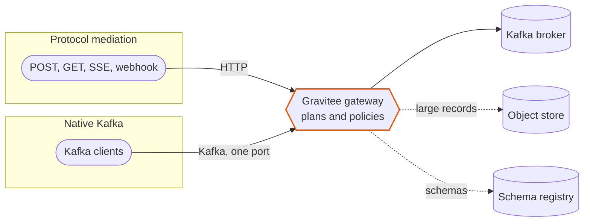
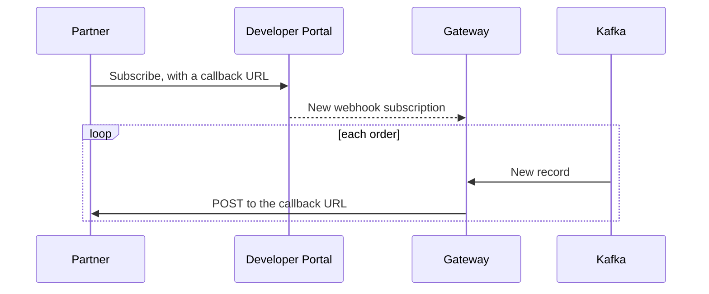
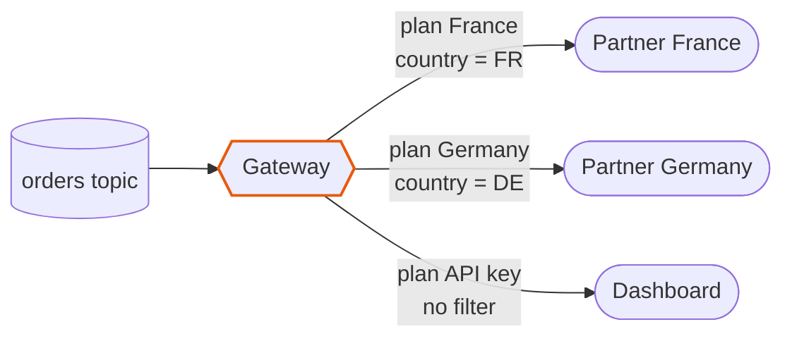
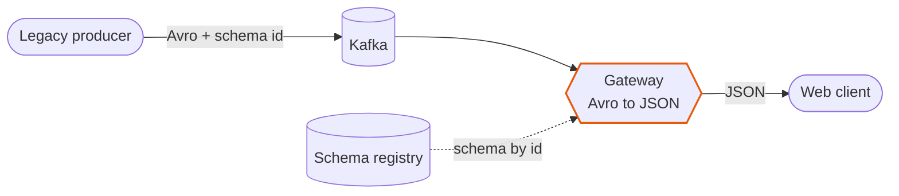
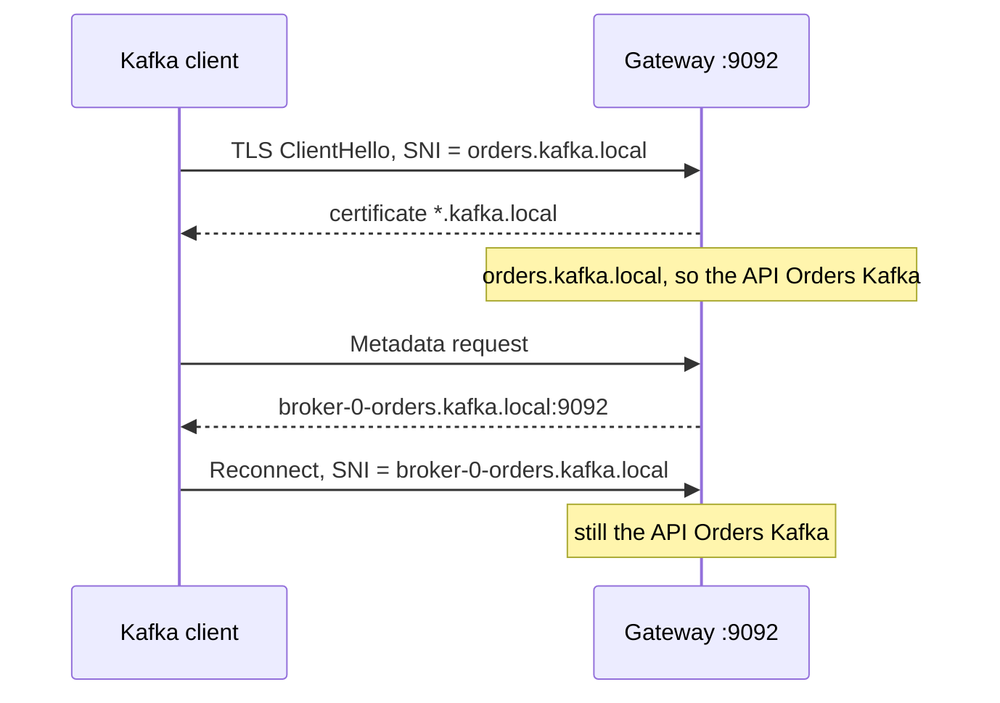
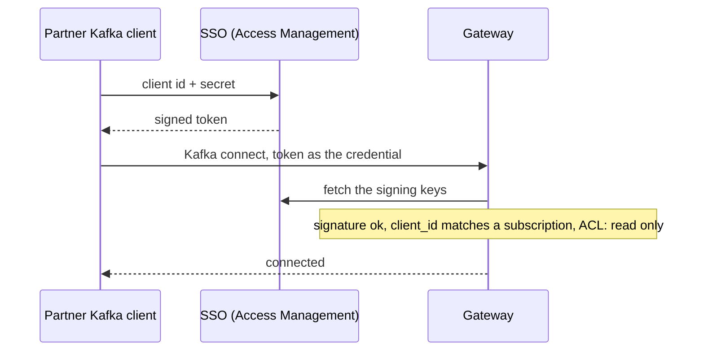
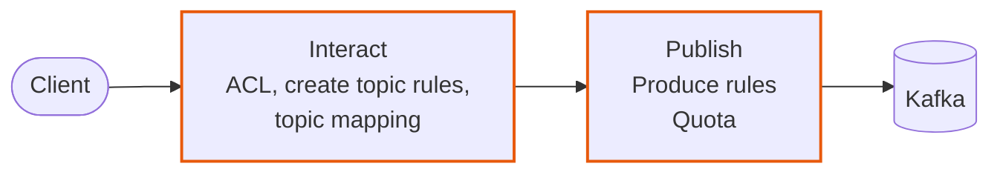
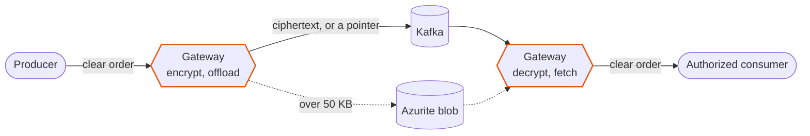

# Event Streams Management with Kafka: control who gets your events

**Your events already flow through Kafka. Who may read them, over which protocol, in which shape, and what happens when a client misbehaves?**

Kafka stores and moves events very well. It does not speak HTTP, it does not give each reader its own view of a topic, and its access rules live on the brokers, in the hands of the people who run them.

**Gravitee sits in front of the brokers.** Your teams, partners and tools talk to the gateway, and the gateway talks to Kafka. Who may connect, what they see and how much they may do become **plans and policies**, managed like the rest of your APIs, with no change to your brokers and no change to your clients.



### The path

| Part | Lessons | You will |
|---|---|---|
| **Protocol mediation** | 1 to 6 | Publish and read the topic over HTTP, SSE and webhooks. Give each reader its own view. Read Avro as JSON |
| **Native Kafka** | 7 to 12 | Let real Kafka clients in with one port, a certificate or an SSO token. Govern a shared cluster, watch who uses what, protect the payload |

The scenario is a shop's **orders** topic, with fictional data. It takes about 70 minutes, and you can stop after any lesson.

### Kafka has ACLs and quotas. Why a gateway?

- **One place, one model.** The same plans, subscriptions and policies cover your REST APIs, your events and your Kafka clients.
- **Owned by the API team.** Onboarding a partner is a subscription, not a change on the brokers.
- **Beyond what a broker can do.** HTTP and webhooks, per-reader views of one topic, Avro to JSON, field encryption, offloading large records, SSO identities.

### How this guide works

- **Buttons run in the demo app.** [Send an order](action:send-order) does what its label says in the **Demo App** tab. No need to switch tabs.
- **Eye buttons open Gravitee Gamma**, the console of the platform, on the page that shows how a lesson is built or what it left in the logs and dashboards. Sign in as `admin` if asked: the password is in the **Details** tab.
- **The Broker column is the truth.** It reads the topic with no gateway in between, so you see what Kafka really stores.
- **Commands run in the terminal** under the tabs. Press **Run** on a block.
- **Policies stay on** until you press [Reset](action:reset). Lessons that need a clean start begin with it.

Check that everything answers: [send a first order](action:send-order). It appears in the **Broker** column within a second.

## 1. Publish an order with one HTTP POST

*Part 1 · Protocol mediation*

**Why it matters.** The checkout, a mobile app and a SaaS tool all produce orders, and none of them has a Kafka client. Adding one to each means a library to maintain, broker addresses to hand out and credentials to rotate, and it puts your cluster in reach of every system. Behind an API, any tool that speaks HTTP can publish, and you control and meter each caller.

**What Gravitee adds.**
- An HTTP `POST` becomes a Kafka produce. The caller sees an API, never a broker.
- Each caller authenticates with an API key, and every call is counted per application.
- The key opens the API, not Kafka. The topic stays private.

**How it is built.**
- The API **Orders Events** has an **HTTP POST** entrypoint on `/orders/` and a **Kafka** endpoint on the topic `acme.orders.v1`. See [the entrypoints](action:open-events-entrypoints) and [the endpoint](action:open-events-endpoints).
- The plan **API key** protects it. The application **Order dashboard** subscribed to it and holds the key.

### Try it

1. [Send an order over HTTP](action:send-http). The **Producer** column shows `202`.
2. Look at the **Broker** column: the order is there, as a record of the topic.

The same call from a terminal, as the checkout would make it:

```bash run
order 1001 249 | curl -s -i -X POST -H "X-Gravitee-Api-Key: $ORDERS_KEY" -H "Content-Type: application/json" -d @- "$GATEWAY/orders/" | head -1
```

[Open the logs of Orders Events](action:open-events-logs) and choose the **Message** view: each call has its entrypoint, `http-post`, its status, `202`, and the application that made it.

**You saw.** One `POST`, and the order is in Kafka. The caller never knew what a topic is, and every call is in the logs with its caller.

**Next:** reading the orders back, with no consumer group to manage.

## 2. Read the orders with GET and SSE

*Part 1 · Protocol mediation*

**Why it matters.** A reporting job wants the new orders every minute, and a dashboard wants each one the moment it exists. Neither wants to manage consumer groups, offsets and rebalances, and a browser cannot speak the Kafka protocol at all. Both get the topic as plain HTTP.

**What Gravitee adds.**
- **GET** returns what arrived since the caller's last call, up to 20 orders.
- **SSE** streams one event per order over a connection that stays open.
- The gateway remembers each subscription's position, so a client that stops resumes where it left.

**How it is built.**
- The same API has two more entrypoints, **HTTP GET** and **Server-Sent Events**: [see them](action:open-events-entrypoints). The `Accept` header chooses which one answers.
- Each subscription is one Kafka **consumer group**. That is where the position lives.

### Try it

1. [Connect an SSE consumer](action:consumer-sse).
2. [Send five orders](action:send-burst). They arrive one by one in the **Consumer** column.

The same two reads from a terminal. The first call returns the orders, a second call returns nothing: the position moved.

```bash run
curl -s -H "X-Gravitee-Api-Key: $ORDERS_KEY" -H "Accept: application/json" "$GATEWAY/orders/" | jq '.items[].content | fromjson'
```

```bash run
curl -sN --max-time 15 -H "X-Gravitee-Api-Key: $ORDERS_KEY" -H "Accept: text/event-stream" "$GATEWAY/orders/"
```

Kafka's side of it: [open the consumer groups of the broker](action:open-explorer-groups) in the Explorer. The group of each HTTP reader is named after its subscription, and its lag is what that reader has not read yet.

**You saw.** Same address, same key. The `Accept` header chose the protocol, and Kafka saw an ordinary consumer both times.

**Next:** partners who cannot hold a connection open.

## 3. Push the orders to a webhook

*Part 1 · Protocol mediation*

**Why it matters.** A fulfillment partner cannot keep a connection open and does not want to poll. It wants a call on its own URL when an order exists. Without a gateway you would build and run that delivery service, and onboard each partner by hand.

**What Gravitee adds.**
- Calls the partner's URL on each order, with the headers and the authentication the partner asked for.
- Lets the partner subscribe by itself in the **Developer Portal**: no ticket, no integration project.
- Owns the delivery, with retries set on the subscription.

**How it is built.**
- A **Webhook** entrypoint on Orders Events, and a **Webhook** plan whose subscription carries the callback URL. [See the plans](action:open-events-plans).
- The partner's application, here **Order notifier**, makes the subscription in the portal.



### Try it

1. [Open the portal catalog](action:open-portal), and sign in as `admin` if asked. The password is in the **Details** tab.
2. Open **Orders Events** and select **Subscribe**, at the top right. The wizard has four steps:
   - **Choose a plan**: the plan **Webhook**, then **Next**.
   - **Choose an application**: **Order notifier**, then **Next**.
   - **Configure Consumer**: the callback URL `http://streams-app:8000/hooks/orders`, then **Next**.
   - **Review**: select **Subscribe**.
3. [Connect the webhook consumer](action:consumer-webhook), then [send an order](action:send-order).

The order lands in the **Consumer** column about a second later. [See the deliveries](action:open-events-webhooks): each call to the callback URL, with the status it got.

One API now serves four protocols. [The traffic dashboard of Orders Events](action:open-events-traffic) ranks them under **Top connectors**: the Kafka endpoint on one side, `http-post`, `sse` and `webhook` on the other.

**You saw.** The subscription belongs to the partner, and so does the callback URL. Gravitee owns the delivery and records each one.

**Next:** not every reader should get the whole order.

## 4. Shape what readers get

*Part 1 · Protocol mediation*

**Why it matters.** The topic holds the complete order, with the email and the card number. Most readers need a subset: the big orders only, no personal data, their own field names. Kafka is all or nothing, so you would write a service to filter and reshape, and run it. The topic itself must stay untouched for everyone else.

**What Gravitee adds.**
- **Message filtering** drops the orders a reader should not get.
- **JSON to JSON** rewrites each message: no email, no card, the amount renamed to `total`.
- Both act on the way out. The topic is never modified.

**How it is built.**
- The flow **Shape the stream** of Orders Events holds two steps in its **subscribe** phase, the phase that runs for each message sent to a reader: **Message Filtering**, which keeps orders of **500 or more**, and **JSON to JSON Transformation**. [Open the Policy Studio](action:open-events-policies), select the flow, then the tab **Event Messages**. Both are marked **OFF** until you switch them on.

What Kafka stores, and what a reader receives:

```json
{ "orderId": "ORD-1", "customer": "Léa", "email": "lea@example.test",
  "country": "FR", "amount": 1500, "card": "4111…" }
```

```json
{ "id": "ORD-1", "customer": "Léa", "country": "FR", "total": 1500 }
```

### Try it

1. [Switch on the filter and the reshape](action:shape-on). The app deploys the API, which takes a few seconds.
2. [Connect an SSE consumer](action:consumer-sse).
3. [Send an order of 30](action:send-low-value). It never arrives.
4. [Send an order of 1500](action:send-high-value). It arrives as a notification, without the card.

The **Broker** column still holds the whole order. In the Policy Studio, reload the page: the **OFF** marks are gone.

**You saw.** Two policies replace a filtering service, and they run in front of every reader at once.

**Next:** a different view for each partner.

## 5. One topic, two partners

*Part 1 · Protocol mediation*

**Why it matters.** Two retail partners, one per country, may each see the orders shipped to their country and nothing else. With Kafka you would create a topic per partner and a job that fills it, then repeat for the next partner. Here a new partner is a contract on the same topic.

**What Gravitee adds.**
- A **plan** is a contract. The plan **France** carries a filter on the country, the plan **Germany** another. Each partner subscribes to its own plan.
- The dashboard's plan has no filter and sees everything.
- Adding a partner is a new plan, not a new topic and not a new job.

**How it is built.**
- Three plans on Orders Events, each with its own API key. [Open the plans](action:open-events-plans).
- The plan flows **France only** and **Germany only** each hold a **Message Filtering** step on the country, so each applies to the subscribers of its plan only. They are listed under **Plan flows** in [the Policy Studio](action:open-events-policies).
- Each partner is an **application** with a subscription to one plan.



### Try it

1. [Reset the demo](action:reset). It switches the policies of lesson 4 off and empties the topic.
2. [Connect as Partner France](action:consumer-france).
3. Send an order shipped to [France](action:send-france), one to [Germany](action:send-germany) and one to [Spain](action:send-spain). Only the French one arrives.
4. [Connect as Partner Germany](action:consumer-germany). It reads the topic from the start, and only the German order is there.
5. [Connect as the dashboard](action:consumer-dashboard). All three are there.

[The logs of Orders Events](action:open-events-logs) name the reader of each stream: **Partner France**, **Partner Germany**, **Order dashboard**.

**You saw.** One topic, three readers, three views. The difference is the plan each reader subscribed to.

**Next:** a topic that is not JSON at all.

## 6. Read an Avro topic as JSON

*Part 1 · Protocol mediation*

**Why it matters.** Your producers write **Avro**, with their schemas in a registry: compact and safe. A web client or a partner cannot decode Avro, and you do not want to hand each of them a registry client. Changing the producers to write JSON would throw away what Avro gives you.

**What Gravitee adds.**
- Reads the schema id at the start of each record, fetches the schema from the registry and answers in JSON.
- The producers keep writing Avro. The registry stays the single source of schemas.

**How it is built.**
- The API **Orders Avro** has a **resource**, `schema-registry`, that points at the registry. [See the resource](action:open-avro-resources).
- Its flow **Read Avro as JSON** has one step in the subscribe phase, the policy **Avro to JSON**. [Open the Policy Studio](action:open-avro-policies).
- The registry is the **Schema Registry** add-on. [See its subjects](http://localhost:8097/subjects).



### Try it

1. [Send an Avro order](action:send-avro) as a legacy producer would. The **Broker** column shows bytes and a schema id, not JSON.
2. [Read it over HTTP](action:consumer-avro). The payload is binary noise, because the policy is off.
3. [Switch on Avro to JSON](action:avro-on).
4. [Send another Avro order](action:send-avro). A few seconds later it arrives as JSON.

**You saw.** Avro stays inside Kafka and JSON goes out. Nothing changed for the producers.

**Next:** the second half, for clients that do speak Kafka.

## 7. Native Kafka: one port, many APIs

*Part 2 · Native Kafka*

**Why it matters.** Kafka clients connect to a broker address. Serving many teams, partners or clusters normally means many addresses, ports and certificates to open, route and secure. Here the clients keep their Kafka libraries and the gateway behaves like a broker, so nothing changes for them except the address.

**What Gravitee adds.**
- **One port and one wildcard certificate** for any number of APIs. The client names the host it wants in the first message of the TLS handshake (**SNI**), and the gateway picks the API from it.
- Its own broker names in the metadata, so the client stays on the same API.
- Policies, topics and plans of their own for each API.

**How it is built.**
- Three native APIs, called **Kafka Services** in Gamma: **Orders Kafka**, **Payments Kafka** and **Partners Kafka**, each with its own host, `orders`, `payments` and `partners`, on the same port. [See the Kafka Services](action:open-kafka-services).
- Two steps of Orders Kafka in the **interact** phase, which covers what a client asks of the cluster: **Kafka Topic Mapping** renames the broker's `acme.orders.v1` to `orders`, and **Kafka ACL** hides every other topic. They are in [the Policy Studio](action:open-kafka-policies), tab **Global**.



### Try it

1. [Probe orders](action:probe-orders). The gateway answers, with the topics of that API.
2. [Probe payments](action:probe-payments). Another API, another topic, the same port.
3. [Probe a host no API has](action:probe-ghost). The handshake succeeds, then the gateway closes the connection.

The same from the terminal: three names, one address, one certificate.

```bash run
for host in orders.kafka.local payments.kafka.local ghost.kafka.local; do echo "== $host"; sni $host; done
```

```bash run
kc -b $KAFKA_ORDERS -L | grep topic; kc -b $KAFKA_PAYMENTS -L | grep topic
```

Each API shows one topic, its own. The broker's real topics are `acme.orders.v1` and `acme.payments.v1`: [see them in the Explorer](action:open-explorer), which reads the broker directly.

**You saw.** A new API is a new host name, not a new port.

**Next:** who is allowed in.

## 8. mTLS: the certificate is the identity

*Part 2 · Native Kafka*

**Why it matters.** Passwords in Kafka client configs leak and are hard to rotate. Kafka ACLs name principals on the broker, so every new client is a change on the broker, made by someone else. With a client certificate, onboarding is a subscription and offboarding is closing it.

**What Gravitee adds.**
- The **mTLS plan** identifies a client by its certificate and matches it to the application that subscribed with it.
- Every connection is then attributed to an application and a plan, which lesson 11 uses.
- No secret travels in the client's configuration.

**How it is built.**
- The plan **mTLS** on Orders Kafka. [See the plans](action:open-kafka-plans).
- The applications **Fulfillment service** and **Billing service** hold their certificates in their settings, and their subscriptions to the plan are what let them in. [See the subscriptions](action:open-kafka-subscriptions).

### Try it

1. [Send as the fulfillment service](action:send-as-fulfillment). Its certificate is registered, so it works.
2. [Send as a stranger](action:send-as-stranger). The certificate is valid, but no application registered it. Refused.
3. [Send with no certificate](action:send-as-anonymous). Refused too, the plan needs one.

[Open the refused connections](action:open-kafka-refused) and choose the **Kafka** view: each is a **Connection error**, with no application. Select the latest one, and the panel says why: a certificate that no subscription knows, or no certificate at all.

**You saw.** Revoking a client is closing a subscription, and the broker never hears about it. Every refusal is logged with its reason.

**Next:** partners who already have SSO.

## 9. SSO for Kafka: a token, not a certificate

*Part 2 · Native Kafka*

**Why it matters.** Your partners already sign in to your SSO for everything except Kafka, where they hold a static secret. Their Kafka clients can use the same identity, with the same expiry and revocation. A partner that leaves is disabled once, in one place.

**What Gravitee adds.**
- The **JWT plan** accepts the token that your SSO issues to the partner's application (OAUTHBEARER), checks its signature against the SSO's keys and matches its `client_id` to a subscription.
- It lives on its own API, here **Partners Kafka**, so one topic serves certificate clients on one API and token clients on another.
- A read-only ACL on that API lets the partner read the orders and forbids it to write.

**How it is built.**
- **Access Management** is the SSO. Its domain `streams` has the application **Partner portal**, which gets tokens with its client id and secret.
- On Partners Kafka, the plan **SSO token** (JWT) points at the SSO's keys. The APIM application of the same name subscribed with the same client id. [See the plan](action:open-partners-plan) and [the ACL](action:open-partners-policies).



### Try it

First look at the token the SSO gives the partner's application, and what it says. Run this in the terminal:

```bash run
claims
```

Then:

1. [Connect as the partner](action:consumer-partner). It reads the orders with its token, with no certificate.
2. [Send as the partner](action:send-as-partner). Refused, the ACL of the API is read only.

A partner whose secret is wrong never gets a token, and a client with no token is turned away by the gateway.

[Open the logs of Partners Kafka](action:open-partners-logs) and choose the **Kafka** view: the partner's connections are attributed to **Partner portal**, the application its token named.

**You saw.** The company's SSO decides who the partner is. The gateway only checks the token.

**Next:** many teams share one cluster, so it needs rules.

## 10. Govern a shared cluster

*Part 2 · Native Kafka*

**Why it matters.** Many teams share the cluster. One creates a topic with any name and 50 partitions, one produces with `acks=0` and no trace, one floods the brokers. Each of these is a ticket and a post-mortem. Broker-side limits exist, but they are set per cluster by the people who run it. Here the rules belong to the API, and apply to every client whatever library it uses.

**What Gravitee adds.**
- **Rules on requests**: the name and size of new topics, minimum guarantees for producers.
- **Quotas** in bytes per second, enforced with Kafka's own throttling.
- All of it at the gateway, with no change to clients or brokers.

**How it is built.**
- Three steps on Orders Kafka, each in the phase of the request it governs. [Open the Policy Studio](action:open-kafka-policies): the first is in the tab **Global**, the other two in **Event Messages**, all marked **OFF**.
- **Kafka Create Topic Rules**, the topic guardrails: a name like `orders-eu` (the prefix `orders-`, then lowercase letters, digits or dashes) and at most 3 partitions.
- **Kafka Produce Rules**, the safe producers: `acks=0` is forbidden, and the header `x-trace` is required.
- **Kafka Quota**: 4 KB per second for each connection, for producers and consumers.



### Try it

**Topics.** Without rules, a team creates what it wants.
1. [Create a topic with a bad name](action:topic-bad-name), then [one with 12 partitions](action:topic-too-big). Both succeed.
2. [Switch on the topic guardrails](action:guardrails-on).
3. Try both again: [bad name](action:topic-bad-name) and [12 partitions](action:topic-too-big). Refused. [A proper one](action:topic-ok) is created.

**Producers.** Without rules, a careless producer goes through.
1. [Send with acks=0](action:send-unsafe). The client reports no error.
2. [Switch on the safe producers](action:safe-producers-on), then [send with acks=0](action:send-unsafe) again. The **Broker** column shows no new record: the gateway refused it, and a producer with `acks=0` never finds out.
3. [Send without the x-trace header](action:send-untraced). Refused. [Send with it](action:send-safe). Accepted.

**Throughput.** One client sends 40 orders over one connection.
1. [Send 40 orders](action:send-flood). They go through fast.
2. [Switch on the quota](action:quota-on), then [send 40 orders](action:send-flood) again. The gateway asks the client to slow down, and the **Producer** column shows for how long.

### Where the details are

- **What the rules stopped.** [Open the health dashboard of Orders Kafka](action:open-kafka-health). Under **Requests: received → forwarded → answered**, the gap between the first two lines is what the gateway kept from the broker.
- **Which rule.** The client only receives *policy violation*. The gateway's log says which rule: open the [Logs page of the Lab UI](http://localhost:9000/#/logs) and pick the gateway.

The order matters too: a step that runs before **Kafka Topic Mapping** sees the name the client used, and one that runs after it sees the name on the broker.

**You saw.** The cluster's rules live in one place and apply to every client.

**Next:** who is doing what.

## 11. See who uses what

*Part 2 · Native Kafka*

**Why it matters.** Before you retire a topic, you need to know who reads it. Before you bill a team, you need to know how much it moves. Kafka sees client ids and consumer groups, which the clients choose for themselves. Through plans and subscriptions the gateway knows who is really on the other end.

**What Gravitee adds.**
- Attributes every connection and every message to an **application** and a **plan**.
- Shows traffic, connection health and logs per API, filtered by application or plan.
- The **Explorer** adds the cluster's own view: topics, messages, consumer groups and lag.

**How it is built.**
- Nothing to configure. Analytics and logs are on for every API, and the attribution comes from the subscriptions of lesson 8.
- In Gamma, **Observability** holds the dashboards and the logs of every API; the **Explorer** reads the broker through the connection **Lab broker**, which the seed made.

### Try it

1. [Reset the demo](action:reset). The rules of lesson 10 would refuse these orders.
2. [Send as the fulfillment service](action:send-as-fulfillment) twice, and [as the billing service](action:send-as-billing) twice.
3. [Send as a stranger](action:send-as-stranger), to leave a failure in the logs.
4. [Open the traffic dashboard of Orders Kafka](action:open-kafka-traffic). **Applications — producing** ranks the two services by what they sent, and **Topics — produced** shows the topic under the name the clients use, `orders`.
5. [Open the logs of Orders Kafka](action:open-kafka-logs) and choose the **Kafka** view. One line per connection, with its status, its application and its client id. The stranger's line is a **Connection error** with no application, because nobody could be identified.
6. [Open the consumer groups in the Explorer](action:open-explorer-groups). Each group, its members and its lag, straight from the cluster.

**You saw.** The gateway turns anonymous traffic into traffic you can attribute, and refused connections are visible too. The time range and the filters are in the address of each page, so a view can be shared as a link.

**Next:** the data itself.

## 12. Protect the payload

*Part 2 · Native Kafka*

**Why it matters.** Orders carry an email and a card number, and some carry a scanned invoice. Whoever reads the topic reads them: an administrator, a backup, a stolen disk. And Kafka is not built for 100 KB records. Encryption in the client means every team does it, and every team does it differently.

**What Gravitee adds.**
- **Field encryption** (AES-256-GCM): Kafka stores `email` and `card` as ciphertext, and the gateway decrypts them for authorized clients.
- **Offloading**: records over 50 KB go to an object store, and the record keeps a pointer.
- **Message filtering** on the Kafka side too, so a consumer gets only the large orders.

**How it is built.**
- Steps of Orders Kafka on the way in (**publish**) and on the way out (**subscribe**): **Kafka Message Encryption & Decryption** and **Kafka Offloading** both ways, and **Kafka Message Filtering** on the way out. [Open the Policy Studio](action:open-kafka-policies), tab **Event Messages**.
- The key is a setting of the playground. The object store is **Azurite**, the Azure Blob emulator, because Offloading supports Azure Blob. The resource `offload-store` points at it. [See the resource](action:open-kafka-resources).



### Try it

**Encrypt.**
1. [Reset the demo](action:reset). The rules of lesson 10 would refuse these orders, and a record written in clear cannot be decrypted, so the topic starts empty.
2. [Switch on the encryption](action:encrypt-on).
3. [Connect the Kafka consumer](action:consumer-fulfillment), then [send an order](action:send-as-fulfillment) as a Kafka client.
4. In the **Broker** column, `email` and `card` are ciphertext, with the headers that say how. In the **Consumer** column, which reads through the gateway, they are in clear.

To see what a broker administrator sees, [open the topic in the Explorer](action:open-explorer-orders) and select **Fetch**: the newest records, with `email` and `card` as ciphertext.

**Offload.**
1. [Switch on the offloading](action:offload-on).
2. [Send a 120 KB order](action:send-large).
3. The **Broker** column shows a pointer of about a hundred bytes, and so does the Explorer after another **Fetch**: an address in the `offloaded-orders` container. The **Azurite** card lists the blob. The consumer still gets the whole order.

**Filter.**
1. [Switch on the filter for Kafka](action:kafka-filter-on).
2. Send [a small order](action:send-low-value), then [a large one](action:send-high-value). Only the large one reaches the consumer.

The HTTP readers of lessons 1 to 6 get the topic as Kafka stores it, ciphertext included: the encryption is in the topic, and only the native API decrypts.

**You saw.** The data is protected where it rests, and readable only through the gateway.

## Recap

| Lessons | Kafka alone | With Gravitee |
|---|---|---|
| 1 to 3 | A Kafka client in every system | POST, GET, SSE and webhook, with a key or a subscription |
| 4 and 5 | A service to filter and reshape, a topic per partner | Policies and plans in front of one topic |
| 6 | Avro readable by Avro clients only | The registry read once, JSON for everyone |
| 7 to 9 | One address per cluster, secrets in client configs | One port, certificates and SSO tokens as identities |
| 10 | Rules enforced by convention and post-mortems | Rules and quotas at the gateway |
| 11 | Client ids chosen by clients | Traffic, health and logs per application and plan |
| 12 | Plaintext in the topic, records limited in size | Encryption at rest and offloading |

## Start again

[Reset](action:reset) switches every policy off and clears the topics. Re-seed in the Lab UI puts the APIs back as the files say, but keeps the policy switches where they are, so reset first.

## If something does not work

- **A Kafka host name does not resolve.** `orders.kafka.local` and the others resolve inside Docker through the **Kafka host names** container. Check that it runs on the Containers page.
- **A native client is refused with a valid certificate.** The gateway learns an application's certificate within seconds of the seed. Wait a little and try again.
- **A policy switch seems to do nothing.** A deployment takes a few seconds to reach the gateway. The switch stays busy until it is done.
- **A read returns nothing.** It already returned everything, because the subscription's position moved. Send an order and read again.
- **The SSO token is refused.** Access Management takes a minute to start. Run `claims` in the terminal: it prints the token once the SSO answers.
